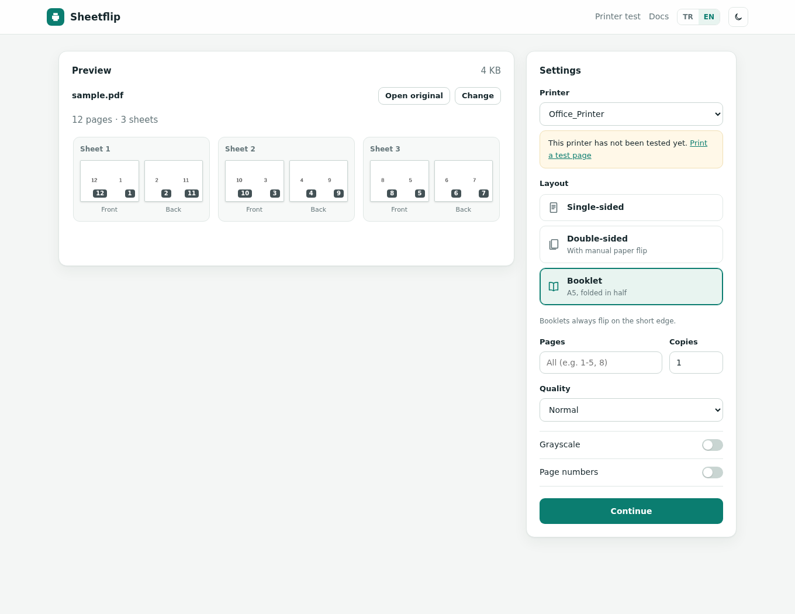
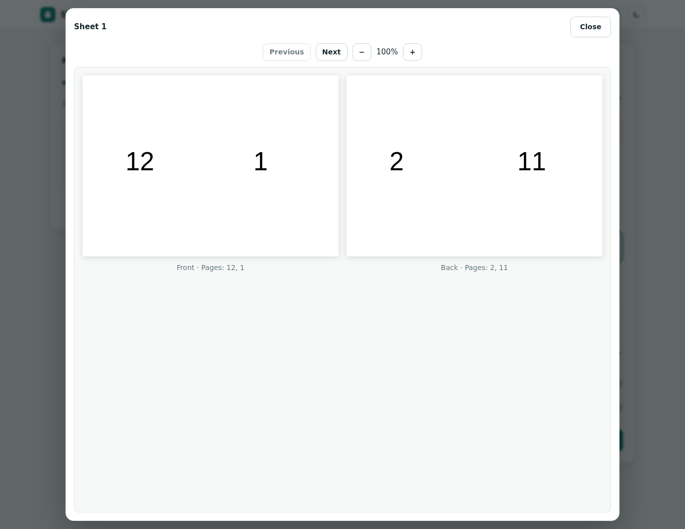
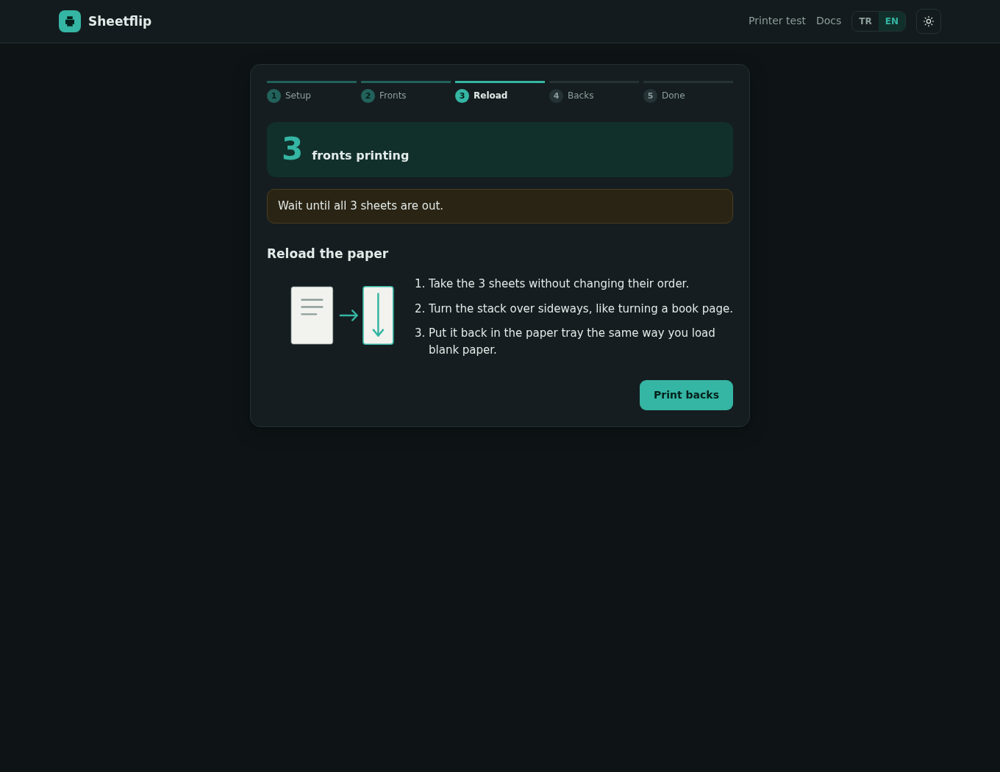

# Sheetflip

Print PDFs on single-sided printers, including manual double-sided printing and folded A5 booklets. Sheetflip sends the front faces first, guides you through reloading the paper, then sends the back faces.

A small Rust web app for Linux and macOS with CUPS. The interface and PDF.js preview renderer are embedded in one executable; no Node.js, CDN or separate frontend server is required at runtime.

[Türkçe](README.tr.md) · [Releases](https://github.com/burakherdogan/sheetflip/releases) · [Changelog](CHANGELOG.md) · [Roadmap](ROADMAP.md)



## Features

- Single-sided, manual double-sided and A5 booklet layouts.
- Any whole number from **1 to 100 pages per face** for single-sided and double-sided jobs. Multi-page layouts use an automatically chosen grid on A4; booklets use two pages per face.
- Front/back sheet previews and a popup viewer with zoom and sheet navigation.
- Page selection, copies, print quality, grayscale, page numbers and long-/short-edge flipping. Booklets use short-edge flipping.
- A two-sheet printer test to save back-face order and rotation for each printer.
- English and Turkish interface; light and dark themes.



## Requirements

- Linux or macOS. **Windows is not supported yet.**
- CUPS with `lp` and `lpstat` available in `PATH`, a configured printer and permission to submit jobs.
- A modern browser with JavaScript enabled.

The executable is self-contained for the application, not for printing: CUPS, printer drivers and the printer queue remain system requirements. Use A4 paper for multi-page and booklet layouts. Printer-driver support determines whether quality, grayscale and other requested options take effect.

## Install and run

Release archives are published on the [releases page](https://github.com/burakherdogan/sheetflip/releases). The v0.1.0 release workflow targets:

| System | Archive |
| --- | --- |
| Linux x86_64 | `sheetflip-v0.1.0-x86_64-unknown-linux-musl.tar.gz` |
| Linux ARM64 | `sheetflip-v0.1.0-aarch64-unknown-linux-musl.tar.gz` |
| macOS Apple silicon | `sheetflip-v0.1.0-aarch64-apple-darwin.tar.gz` |
| macOS Intel | `sheetflip-v0.1.0-x86_64-apple-darwin.tar.gz` |

Download and extract the appropriate archive, then open a terminal in the extracted directory. Start with local-only access:

```sh
LISTEN=127.0.0.1:8080 ./sheetflip
```

Open <http://localhost:8080>. Keep the terminal open while using Sheetflip. The macOS builds are not signed or notarized; macOS may block them. Only approve an executable after verifying its source.

**Security:** without `LISTEN`, Sheetflip binds to `0.0.0.0:8080`, exposing it on all IPv4 interfaces. There is no authentication or built-in TLS. Anyone who can reach the service can submit print jobs and potentially access job documents. Do not expose it to the internet or an untrusted network. Use a local-only binding, firewall or an authenticated proxy as appropriate. Run it as a regular user, not root.

## Use

1. Run **Printer test** from the menu for each printer. Follow the reload instructions and answer the two questions to save its paper-path settings.
2. Drop a PDF onto the main page. Select the printer, layout and other options.
3. Review the sheet faces. Click a face to open the larger popup preview.
4. Submit the front faces. Wait until the printer finishes, reload the stack as shown, then submit the back faces. Single-sided jobs need no reload.



Start with a short document and one copy when checking a new printer or paper tray.

## Configuration

| Environment variable | Default | Purpose |
| --- | --- | --- |
| `LISTEN` | `0.0.0.0:8080` | Listening address and port |
| `DATA_DIR` | `sheetflip` subdirectory of the system temporary directory | Uploaded PDFs, job metadata and generated PDFs |
| `XDG_CONFIG_HOME` | `~/.config` | Base directory for `sheetflip/printers.json` |

Job files are stored on disk. Stale files older than 24 hours are removed when new jobs are created, not by a scheduled cleanup process. Protect the data directory and do not treat Sheetflip as secure document storage.

`./sheetflip --help` shows runtime options; `./sheetflip --version` prints the version.

## Limits in v0.1.0

- Physical printer testing is limited. The printer test helps account for paper paths, but does not guarantee correct results on every printer, tray or driver.
- Preview displays up to the first 24 sheets. It is a layout preview, not an exact simulation of the driver or physical output.
- Annotations and form widgets are **not flattened into imposed PDFs** (multi-page and booklet output). Flatten completed forms and annotations with a suitable PDF tool before printing; otherwise they may be missing from the output.
- Multi-page output uses A4. One-page-per-face output retains source page geometry and is submitted to CUPS with fit-to-page.
- The upload request limit is 200 MiB including form overhead. Large or complex PDFs can consume substantial memory and take time to process.
- There is no automatic duplex hardware control or Windows printing backend.

## Build from source

Requires Rust 1.88 or newer. From the repository root:

```sh
cargo build --release --locked
cargo test --locked
LISTEN=127.0.0.1:8080 ./target/release/sheetflip
```

These are build/test instructions, not a claim that every supported platform or printer has been tested. Report problems through [GitHub issues](https://github.com/burakherdogan/sheetflip/issues), including your OS, printer model, CUPS driver and reproduction steps. Do not attach confidential PDFs.

## License

Sheetflip is MIT-licensed; see [LICENSE](LICENSE). Embedded PDF.js 4.10.38 is Apache-2.0-licensed. See [third-party notices](THIRD_PARTY_NOTICES.md) and the [PDF.js license](licenses/PDF.js-LICENSE).
