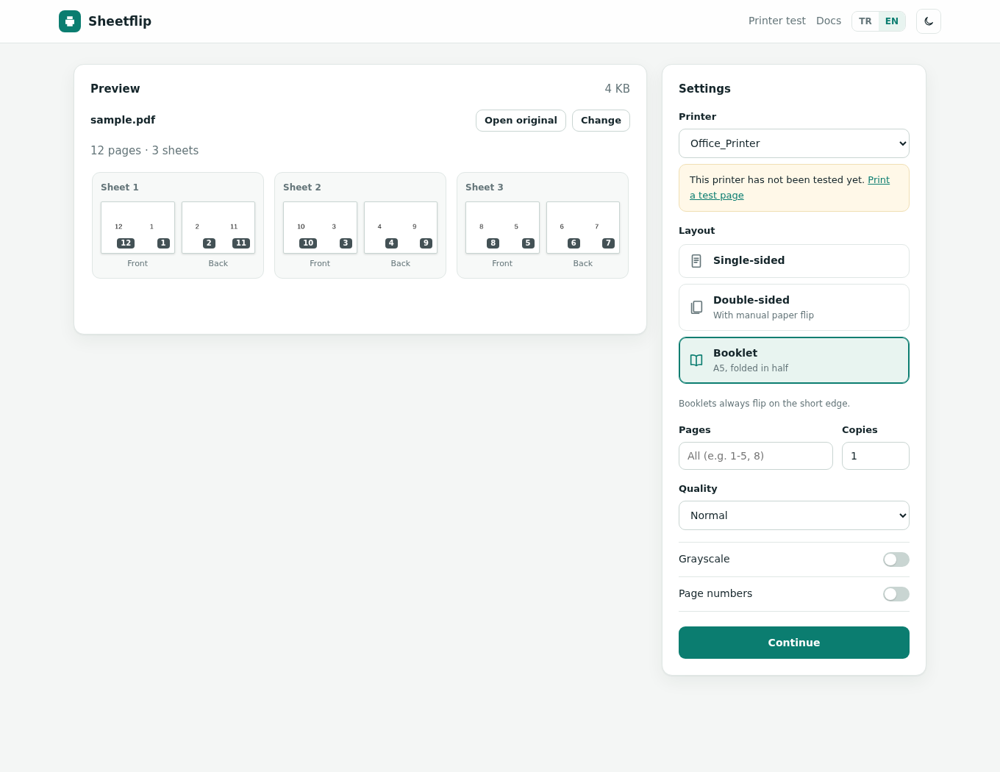
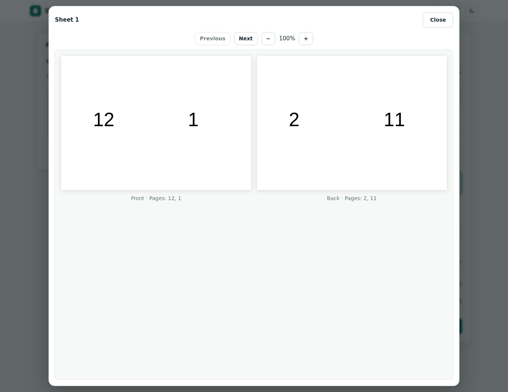
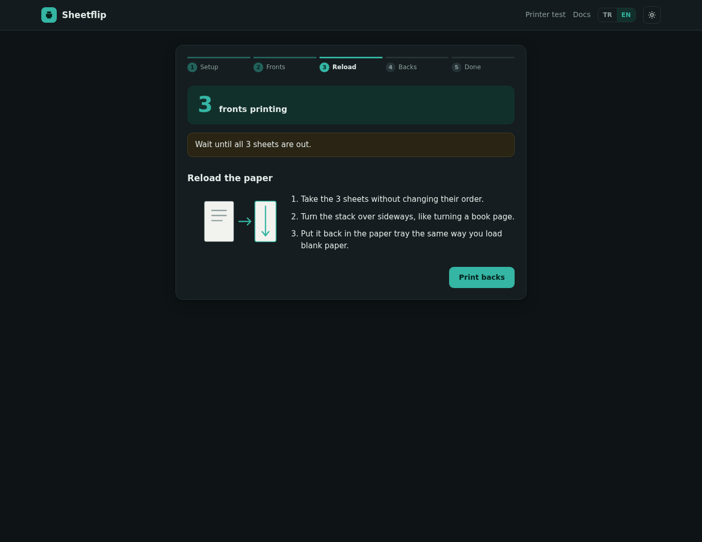

# Sheetflip

Tek yüzlü yazıcılarda PDF yazdırın: elle arkalı önlü baskı ve katlanmış A5 kitapçıklar dahil. Sheetflip önce ön yüzleri gönderir, kağıdı nasıl geri koyacağınızı gösterir, ardından arka yüzleri gönderir.

Linux ve macOS üzerinde CUPS ile çalışan küçük bir Rust web uygulamasıdır. Arayüz ve PDF.js önizleme motoru tek çalıştırılabilir dosyaya gömülüdür; çalışırken Node.js, CDN veya ayrı bir arayüz sunucusu gerekmez.

[English](README.md) · [Sürümler](https://github.com/burakherdogan/sheetflip/releases) · [Değişiklikler](CHANGELOG.md)



## Özellikler

- Tek yüz, elle arkalı önlü ve A5 kitapçık düzenleri.
- Tek yüz ve arkalı önlü işlerde **yüz başına 1–100 arasında her tam sayı** desteklenir. Çok sayfalı düzenler A4 üzerinde otomatik seçilen bir ızgara kullanır; kitapçıklarda yüz başına iki sayfa yerleştirilir.
- Kağıdın ön/arka yüzlerini gösteren önizleme; yakınlaştırma ve kağıtlar arası gezinme sunan açılır pencere.
- Sayfa seçimi, kopya sayısı, baskı kalitesi, siyah-beyaz, sayfa numarası ve uzun/kısa kenardan çevirme. Kitapçıklar kısa kenardan çevrilir.
- Her yazıcı için arka yüz sırasını ve dönüşünü kaydeden iki kağıtlık yazıcı testi.
- Türkçe ve İngilizce arayüz; açık ve koyu tema.



## Gereksinimler

- Linux veya macOS. **Windows henüz desteklenmiyor.**
- `PATH` içinde `lp` ve `lpstat` komutları bulunan CUPS, tanımlı bir yazıcı ve baskı gönderme izni.
- JavaScript açık, güncel bir tarayıcı.

Uygulama tek dosyadır; baskı altyapısı değildir. CUPS, yazıcı sürücüleri ve yazıcı kuyruğu sistemde bulunmalıdır. Çok sayfalı düzenler ve kitapçıklar için A4 kağıt kullanın. Kalite, siyah-beyaz ve diğer seçeneklerin uygulanması yazıcı sürücüsünün desteğine bağlıdır.

## Kurulum ve çalıştırma

Arşivler [sürümler sayfasında](https://github.com/burakherdogan/sheetflip/releases) yayımlanır. v0.1.0 sürüm iş akışının hedefleri:

| Sistem | Arşiv |
| --- | --- |
| Linux x86_64 | `sheetflip-v0.1.0-x86_64-unknown-linux-musl.tar.gz` |
| Linux ARM64 | `sheetflip-v0.1.0-aarch64-unknown-linux-musl.tar.gz` |
| macOS Apple silicon | `sheetflip-v0.1.0-aarch64-apple-darwin.tar.gz` |
| macOS Intel | `sheetflip-v0.1.0-x86_64-apple-darwin.tar.gz` |

Uygun arşivi indirip açın, ardından açılan klasörde bir terminal başlatın. Yalnızca yerel erişimle çalıştırmak için:

```sh
LISTEN=127.0.0.1:8080 ./sheetflip
```

<http://localhost:8080> adresini açın. Kullanım sırasında terminali açık tutun. macOS derlemeleri imzalı veya noter onaylı değildir; macOS bunları engelleyebilir. Çalıştırılabilir dosyaya yalnızca kaynağını doğruladıktan sonra izin verin.

**Güvenlik:** `LISTEN` verilmezse Sheetflip tüm IPv4 arayüzlerinde `0.0.0.0:8080` adresini dinler. Kimlik doğrulama ve yerleşik TLS yoktur. Servise ulaşabilen herkes baskı gönderebilir ve iş belgelerine erişebilir. İnternete veya güvenilmeyen bir ağa açmayın. Gerektiğinde yerel dinleme adresi, güvenlik duvarı veya kimlik doğrulamalı bir vekil sunucu kullanın. Root yerine normal kullanıcıyla çalıştırın.

## Kullanım

1. Her yazıcı için menüden **Yazıcı testi** başlatın. Kağıdı geri koyma adımlarını izleyin ve iki soruyu yanıtlayarak kağıt yolu ayarlarını kaydedin.
2. Ana sayfaya PDF bırakın. Yazıcıyı, baskı düzenini ve diğer seçenekleri seçin.
3. Kağıt yüzlerini kontrol edin. Büyük önizleme penceresini açmak için bir yüze tıklayın.
4. Ön yüzleri gönderin. Yazıcı bitirince desteyi gösterildiği gibi geri koyun ve arka yüzleri gönderin. Tek yüzlü işlerde kağıdı geri koymak gerekmez.



Yeni bir yazıcıyı veya kağıt tepsisini kontrol ederken kısa bir belge ve tek kopyayla başlayın.

## Ayarlar

| Ortam değişkeni | Varsayılan | Amaç |
| --- | --- | --- |
| `LISTEN` | `0.0.0.0:8080` | Dinlenecek adres ve port |
| `DATA_DIR` | Sistemin geçici klasöründeki `sheetflip` alt klasörü | Yüklenen PDF'ler, iş bilgileri ve üretilen PDF'ler |
| `XDG_CONFIG_HOME` | `~/.config` | `sheetflip/printers.json` dosyasının temel klasörü |

İş dosyaları diskte tutulur. 24 saatten eski dosyalar zamanlanmış bir işlemle değil, yeni iş oluşturulduğunda temizlenir. Veri klasörünü koruyun; Sheetflip'i güvenli belge deposu olarak kullanmayın.

`./sheetflip --help` çalışma seçeneklerini, `./sheetflip --version` sürümü gösterir.

## v0.1.0 sınırlamaları

- Fiziksel yazıcı testleri sınırlıdır. Yazıcı testi kağıt yoluna uyum sağlamaya yardımcı olur; her yazıcı, tepsi veya sürücüde doğru sonuç garantisi vermez.
- Önizleme en fazla ilk 24 kağıdı gösterir. Bu bir yerleşim önizlemesidir; sürücünün veya fiziksel çıktının birebir benzetimi değildir.
- Çok sayfalı ve kitapçık çıktılarında **PDF açıklamaları ve form alanları sayfa içeriğine düzleştirilmez**. Yazdırmadan önce doldurulmuş formları ve açıklamaları uygun bir PDF aracıyla düzleştirin; aksi halde çıktıda görünmeyebilirler.
- Çok sayfalı çıktı A4 kullanır. Yüz başına tek sayfalı çıktı kaynak sayfa geometrisini korur ve CUPS'a sayfaya sığdırma seçeneğiyle gönderilir.
- Yükleme isteği sınırı form ek yükü dahil 200 MiB'dir. Büyük veya karmaşık PDF'ler fazla bellek tüketebilir ve uzun sürebilir.
- Otomatik çift taraflı baskı donanımı kontrolü veya Windows baskı altyapısı yoktur.

## Kaynaktan derleme

Rust 1.88 veya üstü gerekir. Deponun kök klasöründe:

```sh
cargo build --release --locked
cargo test --locked
LISTEN=127.0.0.1:8080 ./target/release/sheetflip
```

Bunlar derleme/test komutlarıdır; desteklenen her platformun veya yazıcının test edildiği anlamına gelmez. Sorunları işletim sistemi, yazıcı modeli, CUPS sürücüsü ve tekrar oluşturma adımlarıyla [GitHub issues](https://github.com/burakherdogan/sheetflip/issues) üzerinden bildirin. Gizli PDF'ler eklemeyin.

## Lisans

Sheetflip MIT lisanslıdır; bkz. [LICENSE](LICENSE). Gömülü PDF.js 4.10.38 Apache-2.0 lisanslıdır. [Üçüncü taraf bildirimlerine](THIRD_PARTY_NOTICES.md) ve [PDF.js lisansına](licenses/PDF.js-LICENSE) bakın.
